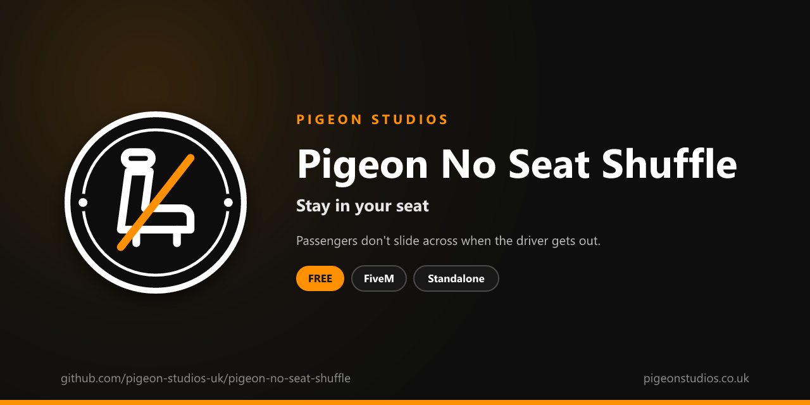

<div align="center">
  

  <h1>Pigeon No Seat Shuffle</h1>

  <p><strong>Stops passengers sliding into the driver's seat by themselves, with a key and /seat to change seats on purpose.</strong></p>

  <p>
    <a href="https://github.com/pigeon-studios-uk/pigeon-no-seat-shuffle/releases/latest"></a>
    <a href="LICENSE.md"></a>
    <a href="https://discord.gg/2NFVWEUmDF"></a>
    
  </p>

  <p>
    <a href="https://github.com/pigeon-studios-uk/pigeon-no-seat-shuffle/releases/latest"><strong>Download</strong></a> ·
    <a href="#installation">Install</a> ·
    <a href="#configuration">Configure</a> ·
    <a href="CHANGELOG.md">Changelog</a> ·
    <a href="https://discord.gg/2NFVWEUmDF">Support</a>
  </p>
</div>

---

## Contents

- [Overview](#overview)
- [Features](#features)
- [What players see](#what-players-see)
- [Requirements](#requirements)
- [Installation](#installation)
- [Updating](#updating)
- [Configuration](#configuration)
- [Localisation](#localisation)
- [Commands and exports](#commands-and-exports)
- [How it works](#how-it-works)
- [Update checker](#update-checker)
- [Performance](#performance)
- [Security](#security)
- [Troubleshooting](#troubleshooting)
- [FAQ](#faq)
- [Support](#support)
- [Contributing](#contributing)
- [Licence](#licence)
- [Credits](#credits)

## Overview

Pigeon No Seat Shuffle is a free resource by [Pigeon Studios](https://pigeonstudios.co.uk) that stops GTA moving passengers into the driver's seat by themselves. In GTA, a player in the front passenger seat slides across the moment the driver's seat is empty. On roleplay servers that means a passenger ends up driving after a traffic stop, a hostage climbs behind the wheel, and nobody can sit and wait in the passenger seat.

With this resource, passengers stay where they sat. When they do want to move, they press a key to shuffle to the seat beside them, or use `/seat` to pick any free seat.

## Features

- **Passengers stay put.** No automatic slide into the driver's seat, for every player.
- **Shuffle on purpose.** A key (O by default) moves you to the seat beside you, if it's free. Players can change the key in GTA's settings.
- **Any seat by number.** `/seat 1` is the driver's seat, `/seat 2` the front passenger seat, then the back seats.
- **Speed limit.** No changing seats above a speed you choose, in mph or km/h.
- **Tells players why.** Short messages when a seat is taken or the vehicle is going too fast. Uses ox_lib notifications if you have it, otherwise GTA's own.
- **Exports.** Other resources can shuffle or move the player to a seat.
- **Survives respawns and model changes.** The setting is applied again straight away when a player respawns.
- **23 languages.** Every message is in `locales/`, and it follows ox_lib's language setting.
- **Standalone.** No framework or other resources needed.

## What players see

A passenger whose driver gets out stays in the passenger seat. Pressing **O** moves them across to the driver's seat. If the seat is taken, or the vehicle is moving too fast, they see one of:

```text
Seats
That seat is taken.
Slow down before you change seats.
```

## Requirements

| Requirement | Version | Notes |
|---|---|---|
| FXServer | A [recommended artifact](https://runtime.fivem.net/artifacts/) | |
| [ox_lib](https://github.com/communityox/ox_lib) | Optional | Messages if it's running |

**Frameworks:** none needed. It works the same on standalone servers, ESX Legacy, QBCore, Qbox and ox_core.

## Installation

1. **Download** `pigeon-no-seat-shuffle.zip` from the [latest release](https://github.com/pigeon-studios-uk/pigeon-no-seat-shuffle/releases/latest). Don't use the green **Code** button; release zips are the tested builds.
2. **Extract** it into your server's `resources` folder. The folder must be called `pigeon-no-seat-shuffle`.
3. **Start it** by adding this to `server.cfg`, after ox_lib if you use it:

   ```cfg
   ensure pigeon-no-seat-shuffle
   ```

4. **Configure** it in `configuration/config.lua` if you want to change anything. The defaults work as they are.
5. **Restart** your server. The console shows one line from the update checker:

   ```text
   [Pigeon Studios] Pigeon No Seat Shuffle v1.0.0 is up to date.
   ```

## Updating

1. Read the [changelog](CHANGELOG.md) for every version between yours and the latest, especially any **Upgrade notes**.
2. Back up your `configuration/` and `locales/` folders.
3. Replace the `pigeon-no-seat-shuffle` folder with the new release.
4. Copy your changed settings into the new `configuration/config.lua`. Don't copy the old file over the new one; new versions can add settings.
5. Restart the resource.

## Configuration

All settings are in `configuration/config.lua`, each explained by a comment next to it.

| Setting | Default | What it does |
|---|---|---|
| `Config.Locale` | `'auto'` | Language: `'auto'` follows ox_lib's language, or a code from `locales/` such as `'de'` |
| `Config.ShuffleKey` | `'O'` | Key that shuffles to the seat beside you. Players can change it in **Settings → Key Bindings → FiveM**. `false` for the command only |
| `Config.ShuffleCommand` | `'shuffle'` | Command that does the same. `false` for no key or command |
| `Config.SeatCommand` | `'seat'` | Command to move to a seat by number. `false` to turn it off |
| `Config.MaxSpeed` | `10` | Fastest the vehicle can be going to change seats. `0` for no limit |
| `Config.SpeedUnit` | `'mph'` | `'mph'` or `'kmh'` |
| `Config.ShowMessages` | `true` | Short messages when a seat change can't happen |
| `Config.Notifications` | `'auto'` | `'auto'` (ox_lib if it's running, otherwise GTA's notification feed), `'ox_lib'` or `'gta'` |
| `Config.ReapplySeconds` | `1.0` | How often the setting is applied again, for characters that change without a respawn |

## Localisation

Pigeon No Seat Shuffle comes in 23 languages: `en` English, `cs` Czech, `da` Danish, `de` German, `es` Spanish, `et` Estonian, `fi` Finnish, `fr` French, `hr` Croatian, `hu` Hungarian, `id` Indonesian, `it` Italian, `nl` Dutch, `no` Norwegian, `pl` Polish, `pt` Portuguese, `pt-br` Brazilian Portuguese, `ro` Romanian, `sl` Slovenian, `sv` Swedish, `tr` Turkish, `zh-cn` Simplified Chinese and `zh-tw` Traditional Chinese. They're the languages ox_lib ships, so your server may already have one set.

With `Config.Locale = 'auto'` (the default), it uses ox_lib's language, so one line in `server.cfg` sets it for this and every other resource that follows ox_lib:

```cfg
setr ox:locale "de"
```

Use `setr`, not `set`, so players' games get it too. Without it, or for a language that isn't in `locales/`, the text is English. To choose a language for this resource only, set `Config.Locale` to its code, such as `'fr'` or `'pt-br'`.

Chinese text can show as blank in GTA's own text, such as its notifications and help messages, because GTA only loads its Chinese font when the game itself is set to Chinese. ox_lib's notifications show every language.

Every file was checked for missing text and placeholders, but not every translation has been read by a native speaker yet. If something reads wrong, please send a fix; see [Contributing](#contributing). To add a language, copy `locales/en.lua` to a new file named with the language's code (such as `ja.lua`), change `Locales.en` at the top to match (`Locales.ja`), and translate the text in quotes.

## Commands and exports

| Command | What it does |
|---|---|
| `/shuffle` | Moves you to the seat beside you, the same as the key |
| `/seat <number>` | Moves you to a free seat: 1 is the driver's seat, 2 the front passenger seat, 3 and 4 the back seats |

Client exports, for other resources:

```lua
-- Move the player to the seat beside them, as the key does.
exports['pigeon-no-seat-shuffle']:Shuffle()

-- Move the player to a seat by number, as /seat does. 1 is the driver's seat.
exports['pigeon-no-seat-shuffle']:MoveToSeat(2)
```

## How it works

GTA has a per-character setting, ped config flag 184 (`PreventAutoShuffleToDriversSeat`), that stops a character sliding into an empty driver's seat. The resource turns it on for each player's own character and keeps it on: straight away on respawn, and every `Config.ReapplySeconds` for anything else that replaces the character.

When a player shuffles on purpose, the flag is turned off for that one move, GTA's own shuffle plays, and the flag goes back on as soon as they're in the new seat. `/seat` puts the player straight into the seat they ask for. Both check first that the seat exists and is free, and that the vehicle is slower than `Config.MaxSpeed`. Bikes, quad bikes and seats with nothing beside them can't be shuffled.

When the resource stops, the flag is turned off and GTA shuffles passengers as before.

## Update checker

When it starts, Pigeon No Seat Shuffle checks our public [version registry](https://github.com/pigeon-studios-uk/pigeon-versions) once and prints one line in the server console saying whether it's up to date. If there's an update, it shows what's new and where to get it. The check is a single request to GitHub and sends nothing about your server or players.

Control it for every Pigeon Studios resource at once in `server.cfg`:

```cfg
set pigeon_update_check "on"      # default: one line per resource
set pigeon_update_check "quiet"   # only when there's an update or a problem
set pigeon_update_check "off"     # never check
```

## Performance

It sets one flag once a second and does nothing else, until a player presses the key or uses `/seat`. Nothing runs every frame, and nothing runs on the server apart from the update check at start-up.

## Security

- It runs only in each player's own game and only moves that player's own character.
- It has two commands, which a player can only use for themselves, and two client exports for other resources on your server. It has no network events, so there is nothing other players or the server can send it.
- Seats are only changed into seats that exist and are free, using GTA's own seat change.
- The only network request is the update check at start-up, from the server to GitHub. It sends nothing about your server or players.
- It sends notifications through ox_lib's local `ox_lib:notify` event when ox_lib is running. Nothing leaves the player's game.
- Like every setting in the player's game, a player with a modified game could get around it. It changes how GTA seats players; it isn't an anti-cheat.

Found a problem? Please don't open a public issue. Use the **Report a vulnerability** button in this repository's **Security** tab, or follow our [Security Policy](https://github.com/pigeon-studios-uk/.github/blob/main/SECURITY.md).

## Troubleshooting

**Passengers still slide into the driver's seat.**
Check the resource is started (`ensure pigeon-no-seat-shuffle`) and there are no errors in the F8 console. Another resource that sets the same flag, or replaces the player's character every frame, can undo it.

**The key does nothing.**
Players who joined before you changed `Config.ShuffleKey` keep their old binding, and anyone can change it in **Settings → Key Bindings → FiveM**. Check `/shuffle` works. If it says the vehicle is too fast, raise `Config.MaxSpeed`.

**The key is already used by another resource.**
Change `Config.ShuffleKey`, or let players bind it themselves in **Settings → Key Bindings → FiveM**.

**The console says "isn't in the version registry" or "couldn't check for updates".**
Your server couldn't reach GitHub, or the check is blocked by a firewall. The resource works normally either way. Turn the check off with `set pigeon_update_check "off"`.

## FAQ

**Is it really free?**
Yes. Use it on as many servers as you like, including ones that take donations. You just can't reupload, resell or bundle it. See [Licence](#licence).

**Can players still get into the driver's seat from the passenger side?**
Yes: press the shuffle key, or use `/seat 1`.

**Does it affect NPCs?**
No. Only players' own characters are changed.

**Does it work in every vehicle?**
In every vehicle with seats side by side. On bikes and quad bikes there's no seat beside you, so only `/seat` works.

**Does it stop players getting in through the passenger door?**
No. Getting in works as normal; they just stay in the seat they got into.

## Support

Read [Troubleshooting](#troubleshooting) first, then ask in the support channels of our [Discord](https://discord.gg/2NFVWEUmDF). Please include your Pigeon No Seat Shuffle version, FXServer artifact and any errors from the console. See [Getting help](https://github.com/pigeon-studios-uk/.github/blob/main/SUPPORT.md).

Found a bug? Open a [bug report](https://github.com/pigeon-studios-uk/pigeon-no-seat-shuffle/issues/new/choose).

## Contributing

Fixes, improvements and translations are welcome. Please read the [contributing guide](https://github.com/pigeon-studios-uk/.github/blob/main/CONTRIBUTING.md) first, and open a feature request before working on anything big.

## Licence

Pigeon No Seat Shuffle is free to use under the **[Pigeon Studios Free Licence](LICENSE.md)**.

- ✅ Use it on any number of servers, including monetised ones
- ✅ Change it for your own servers
- ✅ Show it in videos and streams
- ❌ Don't reupload, share or mirror the files; link to this repository instead
- ❌ Don't sell it, bundle it in packs, or put it behind escrow
- ❌ Don't remove the credits

This summary isn't the licence; [LICENSE.md](LICENSE.md) is. Third-party notices are in [NOTICE.md](NOTICE.md).

## Credits

Made by [Pigeon Studios](https://pigeonstudios.co.uk).

<sub>Not affiliated with or endorsed by Rockstar Games, Take-Two Interactive or Cfx.re.</sub>
